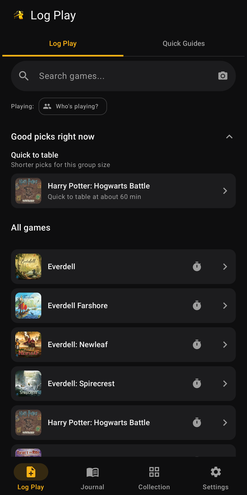
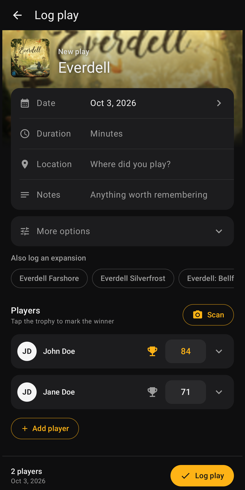
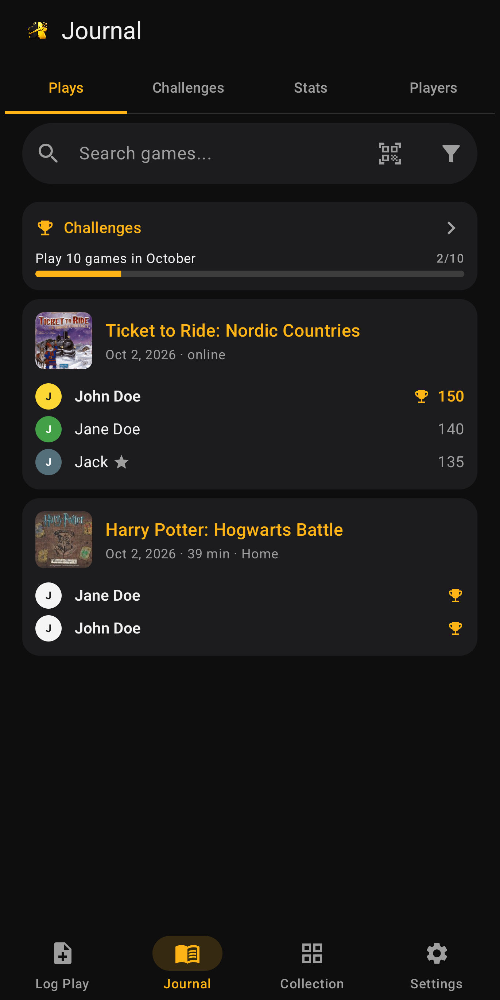
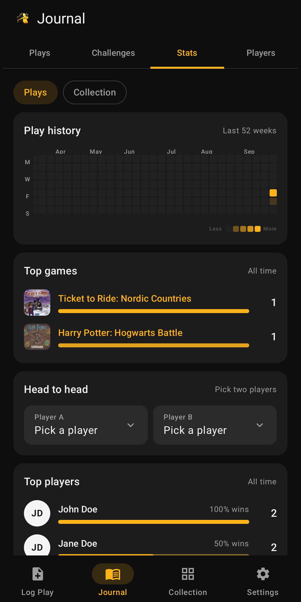
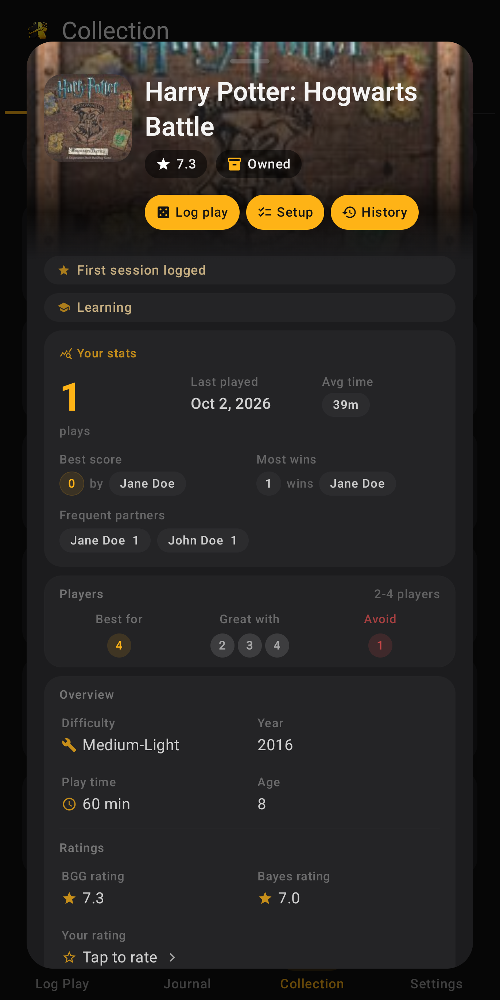

# BoardFlow

**A board game play journal for Android.** Log plays in seconds, score games on built-in score sheets or scan paper ones with AI, set up any game with Quick Setup guides, follow your stats and challenges, and keep your BoardGameGeek collection at hand.

**[Download the latest APK](https://github.com/MartinAlexanderKrul/board-flow/releases/latest)** (Android 8.0+). Each release has the signed `BoardFlow-X.Y.Z.apk` and a `BoardFlow-X.Y.Z-debug.apk` for testing. The two are signed with different keys, so switching between them means uninstalling the other first.

[](https://github.com/MartinAlexanderKrul/board-flow/releases/latest)


<p>
  
  
  
  
  
</p>

## Contents

- [Features](#features)
- [Getting started](#getting-started)
- [Configuration](#configuration)
- [Building, testing and releasing](#building-testing-and-releasing)
- [Architecture](#architecture)
- [Data and privacy](#data-and-privacy)
- [Documentation](#documentation)
- [Contributing guides and score sheets](#contributing-guides-and-score-sheets)

## Features

### Log Play
- Search your collection; a game you don't have is one tap away with "Search BoardGameGeek" (base games and expansions), the same in Log Play, Quick Guides, My Shelf and challenges
- **Good picks right now:** recommendation lanes chosen by day and hour (Weekend deep dive, Weeknight picks, Easy evening, One more before bed), plus Quick to table and Never played. Each pick has a note ("Last played 47 days ago, 9 plays"); swipe one away to hide it for 7 days
- **Expansions:** an expansion played with its base game counts as one sitting. Log Play suggests the game's expansions, "Add expansion" lists every expansion BGG knows, and Edit play adds or removes them. Big boxes count as base games
- **Score sheets:** a score pad for 60+ games (every Wingspan and Everdell game, Finspan, Wyrmspan, Catan, and the Quick Setup games scored at the end) with the game's own scoring rows and icons, sums in cells, expansions switching rows on and off, and tiebreakers. "Use these scores" fills in the totals and the winner. No sheet yet? Gemini drafts one from the rulebook PDF in the background
- A grouped form for date, duration, location, notes, quantity, incomplete and "count in stats"; player rows with scores, teams and winners
- **Score sheet scanning:** a local quality check warns about dark, blurry or distant photos, then Gemini reads players, scores and the game. Recognised players and games are matched to your roster and collection, and the app learns from every confirmed scan
- **Offline first:** every play is saved on the phone first and posted to BGG in the background. Plays saved offline are posted automatically once you are online, or from the Journal outbox
- After saving: record moments (first win, new high score, win streak), challenge progress and "Try next" picks
- A play timer, a "Playing now" banner, and session continuation for game nights

### Quick Guides
- Setup cheat sheets (box, table, first turn) for each game, adjusted to player count, game mode and expansions
- A session checklist, an "Easy to forget" list, and a Start game action that starts the play timer
- 267 guides as open JSON in [`setup-guides/`](setup-guides/), bundled with the app and updated from GitHub without a new release. Every guide works offline
- Edit any guide in the app (rename sections, change, add, remove and reorder steps, set per-player quantities and when a step shows), share it as a file, or import one as your own version (Settings > Preferences > Quick guides); your guides are included in backups
- No guide for a game yet? Pick its rulebook PDF and Gemini drafts one in the background; you get a notification when it is ready. It stays marked as a draft until you check it against the rulebook
- Marking a draft guide or score sheet as reviewed, or saving a guide in the editor, shares it with every BoardFlow user as a pull request on this repo. Only the guide or sheet is sent, nothing about you

### Journal
- **Plays:** every play with players, scores and winners; filters, search, edit, delete with Undo, and an outbox for unposted plays
- **Challenges:** personal goals (play counts, distinct games, streaks, group plays, unplayed games) with progress and deadline reminders
- **Stats:** a Plays / Collection switch. Plays covers activity heatmap, top games and players, rivalries, head-to-head and insights. Collection covers play depth, complexity and sleeve coverage
- **Players:** roster with aliases, BGG usernames and avatar colours
- **Session memory:** moods, a quote and an AI-written chronicle line for each session
- **Sharing:** a play or a whole session as a QR code, importable on another phone

### Collection
- **My Shelf:** your BGG collection with filters for owned, wishlist and played games, play status and best player count. Search for a game you don't have and add it to your BGG collection (owned, wishlist, want to play, ...) from the results
- **Game detail:** opens from every game shown in the app, also for games outside your collection. Your stats, player-count advice, ratings, BGG collection status and rating editing, sleeves, and links to BGG, rules and Drive
- **Sleeves:** sleeves needed per size, owned sleeve counts, per-game exclusions and a preferred brand

### Settings
- **Sync:** accounts (BGG and Google), collection and sleeve refresh, sleeve status backup to BGG, Google Sheets sync, CSV import, Drive folders and QR codes, and a sync log. A sync keeps running when you switch apps and notifies you when it is done
- **Preferences:** stats source, recommendations, chronicles, player colours, expansion plays in BGG win stats, mood templates, sleeve brand, Quick guides (update, import, clear) and Score sheets (update now)
- **Scan:** Gemini key, backup keys and model, and what the app has learned from scans
- **Data:** backup and restore, Add missing base games (gives expansion plays logged alone a base-game play), and cache management

### Widgets
- Last session, daily insight, and this month's plays with the most urgent challenge. Each widget has a camera button that opens a quick scan

## Getting started

### Requirements

| Tool | Version |
| --- | --- |
| Android Studio | a current stable release |
| JDK | 17 |
| Android SDK | platform 36 (compile and target), min SDK 26 (Android 8.0) |
| Gradle | 8.14 (wrapper included) |

### Build and run

```sh
git clone https://github.com/MartinAlexanderKrul/board-flow.git
cd board-flow
./gradlew.bat :app:installDebug      # build and install on a connected device or emulator
```

On macOS or Linux use `./gradlew` instead of `./gradlew.bat`.

The app runs without any accounts: Log Play, Journal and Quick Guides work offline. Add a BGG account in **Settings > Sync** to load your collection and post plays.

## Configuration

Local build settings live in `local.properties` (not committed):

| Key | Purpose | Required |
| --- | --- | --- |
| `BGG_XML_API_TOKEN` | BoardGameGeek XML API token for searching games outside your collection. Can also be set as an environment variable | For BGG search |
| `CONTRIBUTION_RELAY_URL` | URL of the [contribution relay](relay/README.md) that turns reviewed guides and score sheets into pull requests. Empty turns sharing off. Can also be set as an environment variable | For sharing |
| `RELEASE_STORE_FILE` | Path to the release keystore (default `release.jks` in `app/`) | Release builds |
| `RELEASE_STORE_PASSWORD`, `RELEASE_KEY_ALIAS`, `RELEASE_KEY_PASSWORD` | Release signing | Release builds |

Google sign-in (Sheets and Drive) needs external setup:

- `app/src/google-services.json` from the Firebase project
- Android OAuth clients registered with the SHA-1 fingerprints of the debug key, the release key, and Play's app signing key when distributed through Google Play
- OAuth consent screen scopes `drive.file` and `spreadsheets` (see [`SyncConfig.kt`](app/src/main/kotlin/cz/nicolsburg/boardflow/SyncConfig.kt))

User settings such as BGG credentials and the Gemini API key are entered in the app and stored in encrypted preferences.

## Building, testing and releasing

```sh
./gradlew.bat :app:compileDebugKotlin     # fast compile check
./gradlew.bat :app:testDebugUnitTest      # unit tests, including validation of every guide and score sheet
./gradlew.bat :app:assembleDebug          # debug APK: app/build/outputs/apk/debug/
./gradlew.bat :app:assembleRelease        # signed, R8-shrunk APK: app/build/outputs/apk/release/
./gradlew.bat :app:bundleRelease          # Play Store bundle: app/build/outputs/bundle/release/
```

> **Behind an HTTPS-inspecting proxy or antivirus?** If Gradle fails with `PKIX path building failed`, add `-Djavax.net.ssl.trustStoreType=Windows-ROOT` to use the Windows certificate store.

**Continuous integration.** [`.github/workflows/content.yml`](.github/workflows/content.yml) runs on every pull request and every push to `master`: it validates every guide and score sheet (`BundledSetupGuidesTest`, `RepoScoreSheetsTest`) and runs the relay's Node tests. `validate` is a required check on `master`.

**Releases.** Bump `versionCode` and `versionName` in [`app/build.gradle.kts`](app/build.gradle.kts), build with `CONTRIBUTION_RELAY_URL` set, tag the commit (`vX.Y.Z`), and attach both APKs to a GitHub release: `BoardFlow-X.Y.Z.apk` (the signed release build) and `BoardFlow-X.Y.Z-debug.apk` (the debug build, which installs over a debug install and keeps its data). Interim test builds go out as `vX.Y.Z-debug.N` pre-releases and are deleted once the release is published. Google Play distribution is documented in [`play-store/PLAY_RELEASE.md`](play-store/PLAY_RELEASE.md), together with the store listing, privacy policy and Data safety answers.

## Architecture

BoardFlow is a single-module Jetpack Compose app with a small manual dependency container. It uses unidirectional data flow: view models expose `StateFlow`s, and screens render them.

```text
app/src/main/kotlin/cz/nicolsburg/boardflow/
  MainActivity.kt        thin entry point: lifecycle, auth launchers, widget intents
  AppViewModel.kt        log flow, history, roster, recognition, challenges, chronicles, posting
  SyncViewModel.kt       accounts, collection and sleeve refresh, Sheets, Drive, sync log
  auth/                  Google sign-in and authorisation
  core/                  dependency container, navigation routes
  data/                  BGG, Google, Gemini clients; Room store; workers; setup guides; score sheets;
                         contributions; chronicles
  model/                 data classes and the sleeve size database
  ui/                    screens by feature (ui/score is the score sheet), plus the shared design system
                         in ui/common and ui/theme
setup-guides/            Quick Setup guides (bundled in the APK and served as the remote catalog)
score-sheets/            shared score sheets and fixes to built-in ones (the same way)
relay/                   Cloudflare Worker that opens pull requests for shared guides and score sheets
```

| Concern | Where |
| --- | --- |
| Navigation and app shell | `ui/app/AppShell.kt`, `ui/app/NavTransitions.kt`, `core/navigation/AppRoutes.kt` |
| Design system | `ui/theme/` (colours, type, shapes, spacing) and `ui/common/` (`BoardFlowKit`, `BoardFlowUi`, `BoardFlowMotion`, `ScreenTabRow`) |
| Live data | Room via `data/CanonicalCollectionStore.kt` (database version 16) |
| Settings and secrets | `data/SecurePreferences.kt` (encrypted shared preferences) |
| BoardGameGeek | `data/BggApiClient.kt` (XML API, sleeves), `data/BggRepository.kt` (login, plays, collection writes) |
| Google Sheets and Drive | `data/GoogleApiClient.kt`, `auth/GoogleAuthManager.kt` |
| Gemini | `data/GeminiRepository.kt` (score extraction), `data/GeminiModels.kt` (model choice), `data/chronicle/`, `data/setupguide/GeminiGuideDraftGenerator.kt` (guide and score sheet drafts) |
| Quick Setup | `data/setupguide/` (format, validator, resolver, bundled and catalog sources), `ui/setup/` |
| Score sheets | `model/ScoreSheet.kt` (rows and scoring), `data/scoresheet/` (built-in sheets, catalog, JSON, validator, AI drafts), `ui/score/` |
| Sharing | `data/contribution/Contributions.kt` (payload and `ContributionWorker`), `relay/` |
| Background work | `BggSyncWorker` (collection), `BggPlayPostWorker` (unposted plays), `ChallengeNotificationWorker`, `GuideDraftWorker` and `ScoreSheetDraftWorker` (AI drafts), `ContributionWorker` (sharing) |
| Backups | `data/BackupSerializer.kt` (format version 10) |

Key design decisions:

- **Room is the source of truth** for collection, plays, players, challenges, recognition hints, sleeves, the user's own guides and score sheets, and stored BGG game details. Preferences hold settings and credentials only.
- **Source-aware merging.** BGG owns identity, stats and history. Google Sheets owns sheet-only values. Sleeve refresh owns sleeves.
- **Optimistic BGG writes.** The app shows the expected result at once and talks to BGG in the background. One shared lock (`PlayPostLock`) makes sure a play is never posted twice.
- **Content is data.** Guides and score sheets are JSON, checked by validators before they are shown or stored. The repo folders ship in the APK and are downloaded again at most once a day, so fixes reach every install without a release.
- **No hard-coded AI models.** `GeminiModels` picks the newest stable Flash model the key can use, and moves to the next one when a model is busy or retired.

Agents and contributors working on the code should start with [`AGENTS.md`](AGENTS.md): it maps every flow, the UI conventions and the gotchas.

## Data and privacy

BoardFlow has no ads, analytics or accounts of its own. Data stays on the device and in the accounts the user connects: BoardGameGeek, optionally Google Sheets and Drive (only files the app creates, plus the connected sheet), and optionally the Gemini API with the user's own key (score sheet photos, session summaries for chronicles, and rulebook PDFs picked for drafts). Guides and score sheets are downloaded from this GitHub repo. The only BoardFlow service is the contribution relay: when the user reviews a draft or saves a guide in the editor, that guide or sheet alone is sent to it, and the relay keeps the sender's IP address for about an hour for rate limiting. See the [privacy policy](play-store/privacy-policy.md).

## Documentation

| Document | Contents |
| --- | --- |
| [`AGENTS.md`](AGENTS.md) | Architecture, flows, conventions and gotchas: the reference for code changes |
| [`docs/UI_SURFACES.md`](docs/UI_SURFACES.md) | Every screen, dialog and sheet, and the shared components behind them |
| [`docs/GAMIFICATION.md`](docs/GAMIFICATION.md) | Insights, record moments, mastery, challenges, chronicles and recommendations |
| [`docs/WIDGETS.md`](docs/WIDGETS.md) | Home screen widgets |
| [`docs/LOGGING.md`](docs/LOGGING.md) | Logcat tags and filters for debugging |
| [`setup-guides/README.md`](setup-guides/README.md) | Quick Setup guide format and writing rules |
| [`docs/setup-guide-missing-expansions.md`](docs/setup-guide-missing-expansions.md) | Expansions and modules the guides do not cover yet |
| [`relay/README.md`](relay/README.md) | The contribution relay: what it does and how to deploy it |
| [`play-store/`](play-store/) | Google Play listing, privacy policy, Data safety and release checklist |

## Contributing guides and score sheets

Quick Setup guides and shared score sheets are plain JSON files, one per game, in [`setup-guides/`](setup-guides/) and [`score-sheets/`](score-sheets/), each folder with an `index.json`. To add or fix one, follow [`setup-guides/README.md`](setup-guides/README.md) (score sheets use the format in `data/scoresheet/ScoreSheetJson.kt`), bump its `version` in the file and in the index, run `./gradlew.bat :app:testDebugUnitTest` to validate it, and open a pull request. The app can open the pull request for you: reviewing a draft or saving a guide in the editor sends it through the [relay](relay/README.md). Merged content reaches every install through the remote catalogs.

---

BoardFlow is an independent project and is not affiliated with or endorsed by BoardGameGeek.
